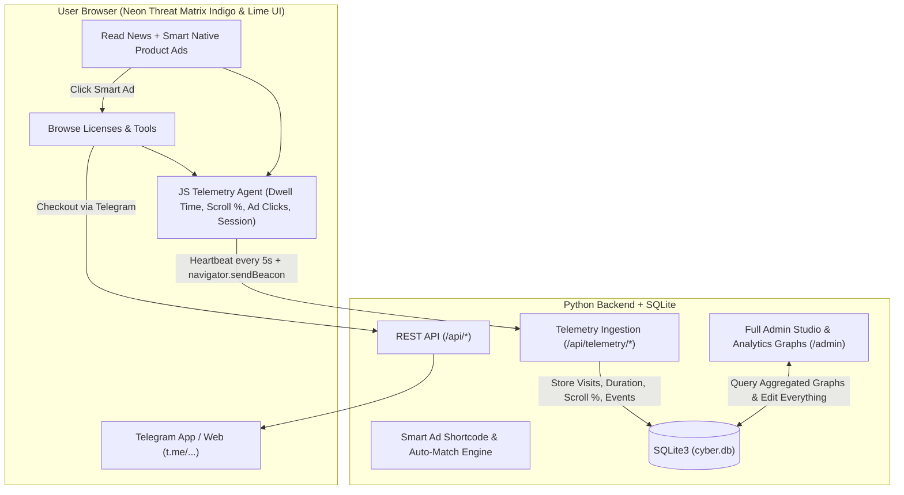

# ZERODAY // ARSENAL & INTEL
> **Neon Threat Matrix (Indigo & Lime) Digital Cybersecurity Store, Threat Intelligence Portal & Full Telemetry Analytics Suite**

---

## 1. Executive Summary & Vision
**ZERODAY // ARSENAL & INTEL** is a complete cybersecurity e-commerce and intelligence platform featuring:
1. **Digital Cybersecurity Storefront:** Selling **100% Digital Security Products**:
   - **Enterprise & Pro Software Licenses:** *Burp Suite Professional*, *Metasploit Pro*, *Splunk Enterprise Security*, *Maltego XL*, *Cobalt Strike / Red Team Frameworks*, *Acunetix / Invicti*, *Nessus Professional*, *Shodan Enterprise API*.
   - **Downloadable Tools, Scripts & Research Bundles:** Custom offensive/defensive scripts, OSINT automation suites, wordlists, YARA/Sigma rule packs, and standalone binaries (with SHA-256 checksum verification).
   - **Telegram-Direct Checkout Flow:** Buyers select products or add them to their cart, generate a unique **Order Reference ID (`ORD-XXXXX`)**, and complete payment & instant license/download delivery directly via **Telegram (`@YourHandle`)** with pre-filled one-click message links.
2. **Threat Intelligence Wire (Cybersecurity News & Blog) with Smart Native Product Ads:**
   - Zero-day advisories, CVE breakdowns, and practical tool tutorials.
   - **Smart Native Product Ad Engine:** Blog articles seamlessly embed **Contextual Tool Callouts (`[product:SKU]`), Auto-Injected Mid-Article Cards, Sticky Sidebar Toolboxes, and End-of-Post Bundles** that match the topic of the post and convert readers into Telegram buyers.
3. **Full Real-Time Website Telemetry, Graphs & Behavioral Analytics Engine:**
   - First-party client + server telemetry tracker (`Beacon API` + heartbeat timer) that records **every page visit, unique visitor session, exact dwell time (seconds stayed on each product or blog post), scroll depth %, smart-ad impressions vs. clicks (CTR), cart additions, and Telegram checkout clicks**—visualized with interactive Indigo & Neon Lime graphs in the Admin Panel.
4. **100% Customizable Command Center (`/admin`):**
   - Full control over all site settings, Telegram handles, products, orders, a rich customizable Blog + Smart-Ad Studio, and the **Visual Analytics & Telemetry Dashboard**.

---

## 2. Visual Design System: "Neon Threat Matrix" (Indigo & Lime Palette)
Built directly from your **Neon Threat Matrix (Indigo & Lime Cybersecurity Firm)** color palette:

### Exact Color Palette Tokens
| Swatch | Token | Hex Code | Usage |
| :--- | :--- | :--- | :--- |
| **1. Deep Abyssal Indigo** | `--bg-primary` | `#17153D` | Main background, terminal backdrop, deep header/footer canvas |
| **2. Royal Cyber Indigo** | `--bg-surface` | `#2F2B75` | Product cards, blog panels, analytics chart cards, modals, sidebar widgets |
| **3. Electric Acid Lime** | `--accent-lime` | `#90E31F` | **Primary Accent:** "Buy via Telegram" CTAs, active tabs, discount badges, primary graph line, smart ad borders |
| **4. Cyber Volt Highlighter**| `--accent-volt` | `#C7FF5E` | Button hover states, glowing highlights, price tags, secondary graph line, active telemetry pulse |
| **5. Ghost Ice White** | `--text-primary` | `#F2F4FF` | Crisp high-contrast headings, body text, specification readouts |
| **Supporting Muted Indigo**| `--text-muted` | `#A5A3C8` | Secondary metadata, timestamps, crossed-out retail prices, axis labels |
| **Indigo Grid Border** | `--border-matrix`| `#433E96` | Structural `1px solid` card & grid lines (turns `#90E31F` on hover) |

### Typography & UI Elements
- **Headings & Display:** Bold geometric uppercase sans-serif (`Space Grotesk` / `Inter`) in Ghost Ice White (`#F2F4FF`) with Electric Acid Lime (`#90E31F`) highlights.
- **Technical Data & Prices:** Monospace (`JetBrains Mono` / `Fira Code`) for versions, SKU codes, CVE IDs, SHA-256 hashes, license durations, and prices.
- **Tactical Matrix Styling:** Deep Indigo (`#17153D`) background with Royal Indigo (`#2F2B75`) cards, crisp `1px solid` borders that glow Acid Lime (`#90E31F`) on hover, and high-visibility Cyber Volt (`#C7FF5E`) buttons with dark `#17153D` bold text for maximum contrast and readability.

---

## 3. System Architecture & Tech Stack

### Technology Stack
- **Backend:** **Python 3** (`Flask` with `Jinja2` templates + JSON REST API + Telemetry Ingestion API)
- **Database:** **SQLite3** (`cyber.db` using Python's built-in `sqlite3` module)
- **Frontend Styling:** **Tailwind CSS** + **Custom Raw CSS** (`static/css/style.css` implementing the exact `#17153D` / `#2F2B75` / `#90E31F` / `#C7FF5E` / `#F2F4FF` Neon Threat Matrix theme)
- **Frontend Interactivity & Charts:** **Vanilla ES6+ JavaScript** (`static/js/main.js` & `static/js/admin.js`) + **Interactive HTML5 Canvas Graphs** styled in Acid Lime (`#90E31F`) and Cyber Volt (`#C7FF5E`).

### System Architecture Diagram


---

## 4. Complete Feature Breakdown

### Module A: Digital Arsenal (Licenses & Downloadable Tools Store)
1. **Product Categories:**
   - `Web & AppSec Licenses` (*Burp Suite Pro*, *Acunetix*, *Invicti*, *Caido Pro*)
   - `Red Team & Exploitation` (*Metasploit Pro*, *Cobalt Strike*, *C2 Frameworks*)
   - `SIEM & Blue Team` (*Splunk Enterprise Security*, *Nessus Pro*, *Elastic Security*)
   - `OSINT & Recon Licenses` (*Maltego XL*, *Shodan Enterprise API*)
   - `Downloadable Tools & Scripts` (Custom Python/Go exploit kits, recon binaries, wordlists, free direct downloads + paid tools unlocked via Telegram)
2. **Product Metadata & Technical Badges:**
   - **Delivery Type Badge:** `ENTERPRISE LICENSE`, `PRO SUBSCRIPTION`, `DOWNLOADABLE TOOL`, `FREE DIRECT DOWNLOAD`.
   - **Price Anchoring:** Displays **Official Retail Price** (crossed out, e.g., ~~$4,750/yr~~) vs. **Our Price** (e.g., `$199` in `#C7FF5E`) + automatic **`SAVE 95%`** badge in `#90E31F`.
   - **Technical Specs:** Version (`v2026.x`), License Duration (`1-Year / Lifetime`), Supported OS (`Windows / Linux / macOS`), and `SHA-256` checksum.
3. **Telegram Checkout & Order Ticket System:**
   - **Instant 1-Click "Buy via Telegram"** button on every product card, product page, and blog smart-ad.
   - **Multi-Item Cart -> Telegram Order Ticket:** Generates `#ORD-XXXXX` and opens `https://t.me/<your_telegram>?text=...` with a formatted list of items and total price.
   - **Order Vault (`/orders`):** Customers can look up `#ORD-XXXXX` to view their unlocked license key or download link once Admin marks it fulfilled.

---

### Module B: Threat Intelligence Blog & "Smart Native Product Ad" Engine
1. **Inline Contextual Native Ad (`[product:SKU]` shortcode or 1-click Admin insert):**
   - Renders a sleek **Royal Indigo (`#2F2B75`) + Neon Lime (`#90E31F`) Tactical Tool Callout Box** inside the article with version, features, retail savings, and 1-click **`BUY ON TELEGRAM`** / **`ADD TO CART`**.
2. **Auto-Injected Mid-Article Native Ad Banner:**
   - Automatically places a native **"RECOMMENDED ARSENAL FOR THIS CVE"** card halfway through the article if enabled.
3. **Sticky Sidebar "Lab Arsenal & Countermeasures" Widget:**
   - Stays visible while reading on desktop, showing 1–3 linked products with instant Telegram purchase buttons.
4. **End-of-Article "Deploy This Setup" Bundle Card:**
   - Displays all tools mentioned in the article with a custom CTA headline per post.

---

### Module C: Full Website Telemetry, Dwell-Time & Graph Analytics Engine
Every visitor interaction is automatically tracked and visualized inside the **Admin Analytics Command Center**:

#### 1. How the Client-Side + Server-Side Tracker Works
- **Visitor & Session Fingerprinting:** Assigns an anonymous session ID (`sid`) and visitor ID (`vid`), capturing Device Type (`Desktop` / `Mobile` / `Tablet`), OS (`Linux`, `Windows`, `macOS`, `Android`, `iOS`), and Referrer source (`Direct`, `Telegram`, `Search`, `Internal Blog Ad`).
- **Exact Dwell Time (Time Stayed on Page) & Scroll Depth Tracker:**
  - Tracks active time on the page in seconds (pausing when the tab is hidden so numbers are 100% accurate) and sends periodic heartbeats + a final `navigator.sendBeacon` payload when the user leaves or navigates away.
  - Records **Maximum Scroll Depth (`0%` to `100%`)** so you know if readers actually finish reading a blog post or stop halfway.
- **Event & Funnel Tracking:**
  - Logs `PAGE_VIEW` (Home, Store, Product Detail, Blog List, Blog Post), `SMART_AD_IMPRESSION`, `SMART_AD_CLICK` (which blog post drove the click and which product was clicked), `ADD_TO_CART`, `FREE_DOWNLOAD`, and `TELEGRAM_BUY_CLICK`.

#### 2. Interactive Graphs & Metrics in Admin (`/admin` -> Analytics Tab)
1. **Top KPI Cards (Real-Time Summary):**
   - **Live Active Visitors Online Right Now** (active within last 60s with `#90E31F` neon pulse)
   - **Total Page Views & Unique Visitors**
   - **Average Time Stayed on Site (Dwell Time)** (split by Product Avg Stay vs. Blog Avg Stay)
   - **Blog vs. Product Traffic Split Ratio**
   - **Smart Ad Click-Through Rate (CTR %)** & **Telegram Checkout Conversion Rate (%)**
2. **Graph 1 — Traffic Timeline (Multi-Line Time-Series Chart):**
   - Compares **Product Views** (`#90E31F` Acid Lime), **Blog Views** (`#C7FF5E` Cyber Volt), and **Telegram Checkout Clicks** (`#F2F4FF` Ice White) over time.
3. **Graph 2 — Product Engagement & Dwell Time Bar Chart:**
   - Side-by-side comparison of **Top Products by Views**, **Average Time Stayed on Each Product (Seconds)**, and **Telegram Buy Clicks**.
4. **Graph 3 — Blog Post Performance, Read Completion & Smart Ad Conversions:**
   - Visual breakdown of **Blog Views**, **Average Read Time Stayed (Seconds)**, **Average Scroll Depth (%)**, and **How Many Product Ad Clicks Each Blog Post Generated**.
5. **Graph 4 — Conversion Funnel & Traffic/OS Breakdown:**
   - **Funnel Chart:** `Total Visitors` $\rightarrow$ `Product / Blog Viewers` $\rightarrow$ `Smart Ad / Cart Clicks` $\rightarrow$ `Telegram Order Generated` $\rightarrow$ `Completed Sales`.
   - **OS & Device Breakdown:** Know if your audience visits from `Kali/Linux`, `Windows`, `macOS`, or `Mobile`.
6. **Detailed Per-Item Analytics Table & Live Activity Feed:**
   - **Product-by-Product Table:** SKU, Total Views, Unique Visitors, **Avg Time Stayed (sec)**, Cart Adds, Telegram Clicks, Conversion %.
   - **Blog-by-Blog Table:** Post Title, Total Views, **Avg Time Stayed (sec)**, **Avg Scroll Depth %**, Smart Ad Impressions, Smart Ad Clicks, Ad CTR %.
   - **Live Visitor Stream:** Real-time log of the latest 50 visitor sessions showing what page they visited, how many seconds they stayed, how far they scrolled, and what they clicked.

---

### Module D: Fully Customizable Command Center (`/admin`)
1. **Analytics & Telemetry Dashboard Tab:** Full visual graphs, dwell-time metrics, blog-to-product conversion stats, and live visitor stream.
2. **Global Site & Telegram Settings Tab:** Edit Site Name, Hero Title/Subtitle, Top Breaking Ticker text, **Telegram `@username`**, Telegram Channel URL, custom Telegram message template, and Admin Password.
3. **Customizable Blog Studio & Smart Ad Builder Tab:** Full post editor with formatting toolbar, 1-click `[product:SKU]` Smart Ad insertion, custom ad pitch per post, severity/CVE badges, and live preview.
4. **Digital Arsenal (Products & Licenses) Manager Tab:** Add, edit, duplicate, or delete any license or downloadable tool, retail vs. store price, specs, SHA-256 hash, and download links.
5. **Telegram Orders & License Fulfillment Tab:** Manage `#ORD-XXXXX` tickets, mark completed, and attach license keys / download links.

---

## 5. Database Schema (SQLite3)

```mermaid
erDiagram
    SETTINGS {
        string key PK "site_name, telegram_user, telegram_channel, ticker_text, hero_title..."
        string value
    }

    PRODUCTS {
        int id PK
        string sku UK "e.g., LIC-BURP-PRO"
        string name "e.g., Burp Suite Professional"
        string slug UK
        string category "Web AppSec | Red Team | SIEM | OSINT | Downloadable Tools"
        string product_type "LICENSE_KEY | DOWNLOADABLE_TOOL | FREE_TOOL"
        float price
        float retail_price
        string version
        string license_duration
        string platform
        string short_desc
        text specs_json
        string sha256_hash
        string download_url
        string badge_text
        boolean featured
        int views_count
        datetime created_at
    }

    POSTS {
        int id PK
        string title
        string slug UK
        string category
        string severity "CRITICAL | HIGH | MEDIUM | INFO"
        string cve_id
        string cvss_score
        string author
        string read_time
        string summary
        text content "HTML/Markdown + [product:SKU] smart ad shortcodes"
        string related_skus
        string ad_mode "ALL | SIDEBAR_ONLY | INLINE_AUTO | NONE"
        string ad_custom_pitch
        boolean featured
        int views
        datetime published_at
    }

    ORDERS {
        int id PK
        string order_number UK "e.g., ORD-73910"
        string buyer_telegram
        float total_amount
        string status "PENDING_TELEGRAM | COMPLETED | CANCELLED"
        text items_json
        text fulfilled_license_info
        datetime created_at
    }

    ANALYTICS_PAGEVIEWS {
        int id PK
        string visit_token UK "Unique ID per page load for heartbeat updates"
        string visitor_id "Persistent anonymous visitor ID"
        string session_id "Browser session ID"
        string page_type "HOME | SHOP | PRODUCT | BLOG_INDEX | BLOG_POST | ORDERS"
        string target_slug "Product slug or Blog slug"
        string target_title "Human readable Product or Blog title"
        int duration_seconds "Exact time stayed on page (updated via heartbeat/beacon)"
        int max_scroll_pct "0 to 100 scroll depth percentage"
        string referrer "Traffic source or internal blog path"
        string device_type "Desktop | Mobile | Tablet"
        string os_name "Linux | Windows | macOS | Android | iOS"
        datetime created_at
        datetime last_ping_at
    }

    ANALYTICS_EVENTS {
        int id PK
        string visitor_id
        string session_id
        string event_type "SMART_AD_IMPRESSION | SMART_AD_CLICK | ADD_TO_CART | TELEGRAM_BUY_CLICK | FREE_DOWNLOAD"
        string source_page "e.g., /intel/cve-2026-burp-guide"
        string target_sku "e.g., LIC-BURP-PRO"
        string meta_info "Placement type e.g. INLINE_AD | SIDEBAR_AD | PRODUCT_PAGE"
        datetime created_at
    }
```



---

## 6. Project Directory Structure

```text
/home/siuxsa/cyber/
├── README.md                  # Full Architecture, Design & Telemetry Blueprint
├── app.py                     # Python Flask Backend (SSR, Smart Ad Engine, Telemetry API, Admin API)
├── database.py                # SQLite3 Schema + Seed Data (Products, Blog Posts, Realistic Historical Analytics)
├── cyber.db                   # SQLite3 Database (auto-created)
├── requirements.txt           # Python dependencies
├── static/
│   ├── css/
│   │   └── style.css          # Neon Threat Matrix (Indigo & Lime) Raw CSS + Graph Styles
│   ├── js/
│   │   ├── main.js            # Store, Cart, Telegram Order Generator & Live Telemetry Heartbeat Agent
│   │   └── admin.js           # Admin Studio, Blog Smart-Ad Editor & Interactive Canvas Graphs
│   └── downloads/             # Sample downloadable tool scripts/archives
└── templates/
    ├── base.html              # Customizable global header, live ticker, Telegram CTA, cart drawer
    ├── index.html             # Customizable Hero + Featured Licenses + Breaking Intel Feed
    ├── shop.html              # Digital Arsenal Catalog (Licenses & Downloadable Tools)
    ├── product_detail.html    # Full Spec Sheet, Retail Savings, SHA-256 & Telegram Buy
    ├── blog.html              # Threat Intelligence Wire with Severity/CVE filters
    ├── post_detail.html       # Article Reader + Smart Inline/Sidebar/Mid-Post Native Product Ads
    ├── order_lookup.html      # Order Ticket Status, Telegram Direct Link & License Key Vault
    └── admin.html             # Full Command Center (Visual Analytics Graphs, Settings, Products, Blog & Orders)
```
