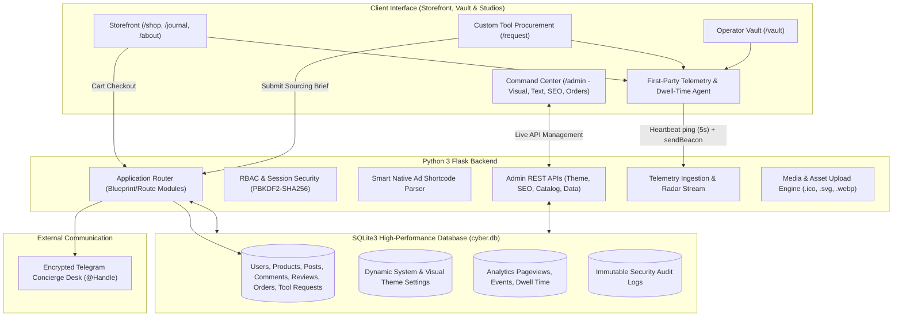
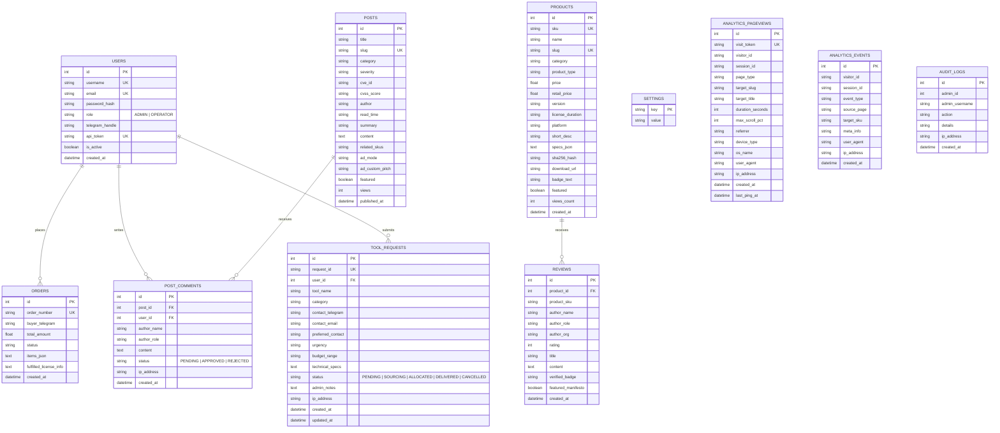

# ZERO//FORM — Architectural Cybersecurity Arsenal & Threat Intelligence Matrix
> **Scandinavian Minimalist & High-Assurance Digital Security Store, Threat Intelligence Journal, Custom Tool Procurement Desk & Telemetry Command Matrix**

---

## 1. Executive Summary & Platform Overview

**ZERO//FORM** is an enterprise-grade digital cybersecurity e-commerce, threat intelligence, and custom tool sourcing platform. Built with Scandinavian architectural minimalism, high-assurance security principles, and strict airgap compliance, it serves security researchers, red teams, penetration testers, and enterprise security operations centers (SOC).

### Core Platform Capabilities
1. **Digital Arsenal Storefront (`/shop`):**
   - **Enterprise Security Licenses & Toolkits:** Commercial binary analysis platforms (*IDA Pro*, *Ghidra Enterprise*, *Binary Ninja*), red team C2 suites (*Cobalt Strike*, *Metasploit Pro*), web application scanners (*Burp Suite Pro*, *Caido*, *Acunetix*), SIEM platforms (*Splunk Enterprise*, *Nessus Pro*), and private threat intelligence feeds.
   - **Downloadable Packages & Binary Artifacts:** Offline installation archives, exploit proof-of-concepts, and verified audit scripts ready for immediate field deployment on isolated operational networks.
   - **Instant Telegram Concierge Dispatch:** Frictionless checkout generating a unique order ticket (`#ORD-XXXXX`) dispatched to an encrypted Telegram concierge desk with automated cart manifests.

2. **Custom Sourcing & Procurement Desk (`/request`):**
   - **Unlisted Asset Intake:** Dedicated procurement portal for operators seeking zero-days, enterprise license seats, reverse-engineering suites, hardware implants, or custom C2 development not listed in the public catalog.
   - **Encrypted Intake Pipeline:** Submits operational requirements, budget allocations ($1k to $20k+), urgency tiers (Standard, High, Immediate), and encrypted contact channels, generating procurement tickets (`#REQ-XXXXX`).
   - **Admin Broker Queue:** Complete intake lifecycle management in the admin dashboard (`PENDING`, `SOURCING`, `ALLOCATED`, `DELIVERED`, `CANCELLED`) with internal broker notes and escrow tracking.

3. **Threat Intelligence Journal (`/journal`):**
   - **Vulnerability Disclosures & CVE Advisories:** High-fidelity technical research, binary dissection, and practical exploitation walk-throughs.
   - **Smart Native Ad Engine:** Injects contextual tool shortcodes (`[product:SKU]`), mid-article recommendation cards, sticky sidebar toolboxes, and end-of-post deployment bundles.
   - **Login-Gated & Moderated Reader Comments:** Authenticated operator commenting with an administrative moderation queue (`PENDING`, `APPROVED`, `REJECTED`) keeping discussions professional and verified.

4. **Operator Security Vault (`/vault`):**
   - **Client License Enclave:** Dedicated portal where authenticated operators access activated software licenses, provisioned license keys, copy-to-clipboard tokens, offline download links, and order transaction history.
   - **API Token Provisioning:** Generates secure `X-API-Token` credentials for automated license provisioning and telemetry sync.

5. **Visual Inspect Studio & Multi-Studio Admin Panel (`/admin`):**
   - **Visual Inspect Studio:** Interactive point-and-click live storefront inspector with responsive viewport toggles (Desktop 1280px, Tablet 768px, Mobile 390px).
   - **Text-Based Content Studio:** Comprehensive form-based copy editor for headlines, descriptions, timeline steps, hero banners, and brand manifestos across all routes.
   - **Dedicated SEO & Metadata Studio:** Real-time Google SERP simulator, OpenGraph card previews, per-page meta titles, and Schema.org structured data.
   - **Brand Logo & Browser Favicon Studio:** Live upload and preview support for SVG, PNG, WebP, and ICO assets.
   - **Telemetry & Data Management System:** Decoupled analytics dashboard with independent export (JSON/CSV) and purge controls isolated from core website data.

---

## 2. Visual Identity: "Nordic Minimalist Cyberpunk"

ZERO//FORM operates at the convergence of Scandinavian architectural minimalism and zero-tolerance offensive security engineering.

### Color Palette Tokens
| Swatch | Token | Hex Code | Purpose |
| :--- | :--- | :--- | :--- |
| **Obsidian Core** | `--bg` | `#0c0d0e` | Deep canvas, terminal backdrops, root background |
| **Surface Dark** | `--surface` | `#141618` | Cards, article containers, modal backdrops |
| **Surface Elevated** | `--surface-elevated`| `#1a1c1f` | Hover overlays, active inspection panels |
| **Electric Cyan** | `--accent-cyan` | `#00e5ff` | Primary tactical accent, highlights, live pulses |
| **Emerald Terminal** | `--accent-green`| `#10b981` | Verification badges, activated licenses, success states |
| **Amber Warning** | `--accent-amber`| `#f59e0b` | High urgency badges, escrow indicators |
| **Crimson Alert** | `--accent-red` | `#ef4444` | Critical CVE tags, access denied, purge buttons |
| **Ghost White** | `--text` | `#f0f0f2` | Primary typography, headers, high-contrast labels |
| **Matrix Muted** | `--muted` | `#8c9096` | Technical sublabels, timestamps, secondary metadata |
| **Tactical Border** | `--border` | `rgba(255, 255, 255, 0.1)` | Structural 1px division lines |

---

## 3. System Architecture & Tech Stack



### Technology Highlights
- **Backend Framework:** Python 3 with Flask, Werkzeug security, and Jinja2 templating.
- **Persistence:** SQLite3 (`cyber.db`) with WAL mode, foreign keys, and atomic transactions.
- **Frontend Layer:** Semantic HTML5, CSS custom properties, vanilla ES6+ JavaScript modules.
- **Security Engineering:** PBKDF2 password hashing, secure session cookies, CSRF protection, sanitized admin gateway (zero credential leaks), and strict input validation.
- **Telemetry System:** Non-blocking first-party beaconing tracking dwell time, scroll percentage, and conversions without third-party tracking scripts.

---

## 4. Complete Module Guide

### Module 1: Digital Arsenal & E-Commerce (`/shop`, `/product/<slug>`)
- **Product Categorization:** Web & AppSec, Offensive & Red Team, SIEM & Blue Team, Reverse Engineering, OSINT & Recon, Downloadable Tools.
- **Technical Badges & Release Metadata:** Product type (`LICENSE_KEY`, `DOWNLOADABLE_TOOL`, `FREE_TOOL`), version strings, supported OS platforms, verification status, and retail savings calculation.
- **Cart & Concierge Checkout:** Drawer cart modal supporting multi-item selection with instant Telegram dispatch pre-formatting order reference tickets.
- **Customer Reviews Studio:** Product reviews with verified deployment badges, star ratings, and custom editorial curation controls.

### Module 2: Custom Tool Sourcing & Procurement (`/request`)
- **Intake Desk:** Public procurement form allowing operators to request unlisted tools, enterprise licenses, zero-days, and custom payloads.
- **Ticket Generation:** Automatically assigns unique reference tickets (`#REQ-XXXXX`).
- **Admin Intake Queue (`ADMIN` → `ORDERS` → `CUSTOM TOOL REQUESTS`):**
  - Live filtering by status (`PENDING`, `SOURCING`, `ALLOCATED`, `DELIVERED`, `CANCELLED`).
  - Modal editor to update status, append internal broker notes, and view contact handles.
  - Permanent deletion and audit logging.
- **Full Studio Editability:** All headlines, form card labels, timeline protocol steps, and concierge cards on `/request` are fully editable via Text, Visual, and SEO studios.

### Module 3: Threat Intelligence Journal & Moderated Comments (`/journal`)
- **Dispatches & CVE Advisories:** Markdown and HTML rendering of security disclosures, severity ratings (`CRITICAL`, `HIGH`, `MEDIUM`, `INFO`), and CVSS scores.
- **Smart Product Ads:** Dynamic shortcodes (`[product:SKU]`), automated midpoint recommendation cards, and sticky sidebar countermeasure toolboxes.
- **Login-Gated Reader Comments:**
  - Unauthenticated visitors see an authentication requirement gate.
  - Authenticated operators submit comments that enter an administrative moderation queue (`PENDING`).
  - Master Admin can approve, reject, or permanently purge comments. Only approved comments render on public dispatches.

### Module 4: Operator Vault (`/vault`)
- **License Provisioning:** Lists all fulfilled orders with unmasked cryptographic license keys, copy-to-clipboard helpers, and direct download links.
- **Transaction History:** Real-time log of previous order tickets with direct concierge link support.
- **API Access:** Generates unique operator tokens for programmatic license synchronization.

### Module 5: Visual Inspect Studio (`ADMIN` → `THEMES` → `VISUAL INSPECT MODE`)
- **Responsive Viewport Canvas:** Emulates Desktop (1280px), Tablet (768px), and Mobile (390px) inside an interactive sandboxed canvas.
- **Route Switcher:** 1-click navigation between `/` (Home), `/about` (Manifesto), `/shop` (Arsenal), `/journal` (Threat Intel), `/request` (Tool Procurement), and `/404` (404 Error Page).
- **Point-and-Click Inspector:** Clicking any element with `data-theme-bind` on the canvas (including 404 headers, error badges, and body directives) opens an instant quick-edit popup that updates the live DOM in real time.

### Module 6: Text-Based Content Studio (`ADMIN` → `THEMES` → `TEXT-BASED EDIT MODE`)
- **Dedicated Subtabs:**
  - `[01] HOME PAGE CONTENT`: Hero headlines, elevator descriptions, key art banners, category banner strip, and curated product/journal serials.
  - `[02] ABOUT & MANIFESTO`: Tenet blocks, compliance metrics, key art banner, and bottom CTAs.
  - `[03] DIGITAL ARSENAL (SHOP)`: Shop eyebrows, catalog headline, and subtitles.
  - `[04] THREAT JOURNAL`: Disclosure alert badge, headline, and editorial subtitle.
  - `[05] CUSTOM TOOL REQUEST PAGE`: Protocol dispatch banner, form headings, 3-phase timeline protocol steps, and concierge card copy.
  - `[06] 404 ERROR PAGE`: Tactical incident status badge, glitch title code (`404 // ROUTE_NOT_FOUND`), cyan sub-headline alert, explanatory directive prose, return CTA button text & target URL, and search bar toggle.
  - `[07] GLOBAL SHELL & BRANDING`: Brand callsign, tagline, ticker announcements, logo upload, browser favicon upload, and compliance disclaimer.
  - `[08] TYPOGRAPHY, PALETTE & CSS`: 11 custom color tokens, font family configuration, and custom CSS override injection.

### Module 7: Dedicated SEO & Social Metadata Studio (`ADMIN` → `SEO & METADATA`)
- **Real-Time Simulators:** Live Google Search SERP simulator and OpenGraph social share card preview.
- **Per-Page Granular SEO:** Meta titles, meta descriptions, search keywords, and social OG images for Global Defaults, Home (`/`), About (`/about`), Shop (`/shop`), Threat Journal (`/journal`), and Custom Tool Request (`/request`).
- **Live Character Counters:** Real-time validation badges ensuring optimal title (< 60 chars) and description (< 160 chars) length.

### Module 8: Favicon & Brand Logo Management
- **Site Brand Logo:** Upload vector SVG, PNG, or WebP logos with live preview. Replaces text brand across header, mobile slide-out menu, and footer.
- **Browser Tab Favicon:** Upload `.ico`, `.png`, `.svg`, or `.webp` files with live browser tab mockup. Automatically updates `<link rel="icon">`, `<link rel="apple-touch-icon">`, and the `/favicon.ico` redirection endpoint.

### Module 9: Telemetry & Data Management System (`ADMIN` → `SETTINGS` & `ANALYTICS`)
- **Decoupled Architecture:** Telemetry tracking is completely decoupled from core website data.
- **Server-Side 30-Minute Sliding Visitor Cookie Provisioning (`zf_visitor_id` & `zf_session_id`):** 
  - Every page visit provisions/refreshes an authoritative server cookie with a 30-minute lifetime (`max_age=1800` seconds / 30 mins).
  - **Cryptographic Cookie & Visitor Number Counting Architecture:**
    - The browser receives a high-assurance **256-bit cryptographic token** (`secrets.token_hex(32)`).
    - In analytics storage, the **full cryptographic cookie is NEVER stored**.
    - The system counts the number of how many cookies were used as visitors, storing strictly the clean visitor number (e.g. `1`, `2`, `3`...).
    - `visitor_cookie_registry` maps SHA-256 digests of active cookies to their visitor count numbers without storing plaintext cookies.
  - **Single User Deduplication:** While this cookie is present in requests, repeated page reloads and site navigation identify the operator as the same user and NOT a new user, preventing artificial visitor count inflation.
  - **Cookie Destruction & Clean Storage:**
    - Inactivity beyond 30 minutes automatically destroys the cookie in the browser.
    - Client-side storage (`localStorage` and `sessionStorage`) is actively purged of any lingering tracking tokens on every visit, ensuring zero persistent client residue.
    - Database storage in `cyber.db` automatically prunes stale telemetry logs older than 30 days to keep disk footprints lean.
    - Once the 30-minute cookie expires, the next visit provisions a fresh cryptographic cookie token and increments the visitor count number for the new session.
- **Whole-Website Active Visitor Session Holding (Not Per Page):**
  - While the 30-minute visitor cookie is active, the entire website holds the visitor as ONE user session, regardless of how many different pages (Home, Shop, Journal, Product details) they navigate.
  - Page switches update the active visitor record (updating current location, cumulative dwell time, and ping timestamp) rather than spawning new session rows for every page clicked.
  - Granular catalog and blog readership metrics are maintained via `analytics_events` (`PRODUCT_VIEW`, `BLOG_VIEW`) to ensure product reach analytics remain accurate without inflating website user counts.
- **Cloudflare CDN & Proxy-Aware Real Origin IP Resolution (`get_client_ip`):**
  - High-assurance real IP extraction prioritizing Cloudflare CDN headers: `CF-Connecting-IP` → `True-Client-IP` → `X-Forwarded-For` (leftmost sanitized client IP) → `X-Real-IP` → `request.remote_addr`.
  - Immunizes visitor logging, order records, comments, custom tool sourcing requests, and security audit logs against CDN/reverse-proxy IP masking.
- **Raw Client User-Agent Capture & Architecture Radar:**
  - Captures full browser and system User-Agent strings directly in `analytics_pageviews` and `analytics_events`.
  - Replaces generic OS strings with granular client browser detection (Chrome, Firefox, Safari, Edge, Opera, Tor/Brave) across live stream radars, doughnut breakdown charts, and data matrices.
- **Real-Time Readout:** Live pageviews, tracking events, unique visitor entities, and physical database file footprint.
- **Consolidated Controls:** Unified single-line button matrix (`CATALOG (10)`, `INTEL REACH (10)`, `LIVE STREAM (10)`, `SHOW ALL (20 / PAGE)`) with independent subnav anchoring.
- **Safe Export & Purge Tools:** Export tracking records to JSON or CSV (including real origin IP and client User-Agent). Purge telemetry records or vacuum the database with custom confirmation modals without touching products, orders, user accounts, comments, or reviews.

### Module 10: Custom 404 Anomaly Architecture & Unified Visual/Text Editor (`ADMIN` → `THEMES`)
- **Nordic Cyberpunk 404 Experience:** Custom Scandinavian terminal error layout styled with glowing holographic wireframes, glitch headers, tactical breadcrumbs, and instant recovery actions.
- **Dual Handling Pipeline:** `@app.errorhandler(404)` dispatches clean JSON error responses (`{"ok": false, "error": "Endpoint not found", "status": 404}`) for `/api/*` requests while serving the styled cyberpunk experience for public storefront traffic.
- **Unified Text Studio Subtab (`THEMES` → `TEXT-BASED EDIT MODE` → `404 PAGE`):** Direct form control over all copy and routes alongside Home, About, Shop, Journal, and Request:
  - `404 Status Badge`: Tactical incident classification label (e.g. `SURFACE ANOMALY DETECTED`).
  - `Main Display Code / Title`: Big glitch headline (e.g. `404 // ROUTE_NOT_FOUND`).
  - `Anomaly Sub-Headline`: Cyan alert notice (e.g. `TARGET COORDINATES COMPROMISED OR NON-EXISTENT`).
  - `Explanatory Message / Directive`: Contextual instructions and telemetry prose.
  - `Return CTA Button & Target URL`: Configurable CTA label and destination link.
  - `Asset Search Box Toggle`: Display or hide the catalog search input on the 404 page.
- **Visual Inspect Canvas Integration (`THEMES` → `VISUAL INSPECT MODE` → `404 PAGE`):**
  - Instant 1-click preview of the live 404 page in Desktop (1280px), Tablet (768px), and Mobile (390px) viewports.
  - Full point-and-click inspect support: click any headline, badge, or message directly inside the canvas to open the quick-edit popup with real-time DOM synchronization.
- **Live Preview Route:** Dedicated `/404-preview-live` route allowing operators to inspect the 404 layout directly without triggering server errors.

### Module 11: Global Cyberpunk Confirmation Modal Architecture (`#modal-confirm` / `window.showConfirmModal`)
- **Native Browser Replacement:** Replaces crude, unstyled browser `confirm()` popups with a high-fidelity modal window seamlessly integrated with the design system.
- **Async Promise-Based API:** Invoked asynchronously via `window.showConfirmModal({ title, message, badge, confirmText, cancelText, confirmClass })`, returning a boolean `Promise<boolean>`.
- **Tactical Severity Styling:** Dynamic button accents (`btn-danger` in crimson alert for destructive purges vs `btn-primary` in electric cyan for reversible actions).
- **Universal Admin Coverage:** Standardized across all admin delete triggers: catalog items, journal posts, customer orders, moderated comments, client reviews, operator accounts, custom procurement tickets, and telemetry purges.

### Module 12: High-Density Studio Panels & Bounded Viewport Tables
- **Sticky Studio Action Bars:** Product Studio (`mod-product-editor`), Journal Studio (`mod-post-editor`), and Settings Subtabs (`mod-settings`) pinned at `top: 112px` during vertical scrolling so save buttons, publishing status, and tabs remain reachable.
- **Bounded Table Viewports:** Data tables wrapped in `.admin-table-scroll-viewport` (bounded to `max-height: 520px`) with pinned sticky headers (`thead th { position: sticky; top: 0; z-index: 10; }`), enabling independent scroll within catalog, intel, order, and comment matrices.
- **Uniform Column Geometry:** Preserves native data alignment with full width consistency across Desktop, Tablet, and Mobile devices.
- **Viewport-Safe Admin Topbar:** Flexible `.admin-header-nav` with smooth horizontal scrolling, responsive subtitle suppression under 1440px, and operator badge condensation under 1320px to ensure the Logout button is always within viewport bounds at 100% zoom.

---

## 5. Database Schema Reference



---

## 6. Directory Structure

```text
/home/siuxsa/cyber/
├── README.md                          # Full Architecture, Engineering & Operational Blueprint
├── app.py                             # Core Flask Application & Bootstrap Engine
├── database.py                        # SQLite3 Schema Migrations & Initial Seed Data
├── cyber.db                           # Primary SQLite3 Database
├── requirements.txt                   # Production Python Dependencies
├── wsgi.py                            # Production WSGI Server Entrypoint
├── core/
│   ├── config.py                      # System Configuration, Allowed Extensions, Default Schema
│   ├── helpers.py                     # Markdown Processor, Smart Ads Engine, Audit Logger
│   └── security.py                    # Session Management, Authentication Guards, RBAC
├── routes/
│   ├── __init__.py                    # Central Route Registration Gateway
│   ├── frontend.py                    # Public Storefront, Catalog, Journal, Custom Request Desk
│   ├── auth.py                        # Operator Vault Auth, Registration, Sanitized Admin Login
│   ├── orders.py                      # Checkout API & Slide-Out Cart Dispatch
│   ├── telemetry.py                   # First-Party Telemetry Ingest & Real IP/UA Tracking
│   └── admin/
│       ├── panel.py                   # Master Admin Dashboard Controller
│       ├── products.py                # Arsenal Catalog Management APIs
│       ├── posts.py                   # Threat Intelligence & Smart Ad Editor APIs
│       ├── comments.py                # Reader Comments Moderation APIs
│       ├── reviews.py                 # Customer Reviews CRUD & Home Curation APIs
│       ├── tool_requests.py           # Custom Tool Sourcing Intake Management APIs
│       ├── settings.py                # System Settings, Data Management & Telemetry Purge APIs
│       ├── theme.py                   # Theme Colors, Media Uploads, Home Curation APIs
│       ├── users.py                   # Operator Account Management APIs
│       └── audit.py                   # Immutable Audit Log Viewer APIs
├── static/
│   ├── css/
│   │   ├── style.css                  # Nordic Cyberpunk Core Design System
│   │   ├── responsive.css             # Viewport Layouts & Media Queries
│   │   └── admin.css                  # Modular Admin Command Center Styles
│   ├── js/
│   │   ├── main.js                    # Storefront Interactivity, Search & Mobile Nav
│   │   ├── cart.js                    # Slide-Out Cart Drawer & Telegram Dispatch
│   │   ├── telemetry.js               # First-Party Dwell Time & Scroll Beaconing
│   │   └── admin/
│   │       ├── admin_core.js          # Tab Switching, Toasts & Global Helpers
│   │       ├── admin_analytics.js     # Live Telemetry Charts & Visitor Radar Stream
│   │       ├── admin_orders.js        # Order Fulfillment & Key Provisioning
│   │       ├── admin_tool_requests.js # Custom Tool Sourcing Intake Queue Controller
│   │       ├── admin_products.js      # Product Catalog Studio
│   │       ├── admin_posts.js         # Journal Editor, Markdown Preview & Smart Ads
│   │       ├── admin_comments.js      # Comment Moderation Controller
│   │       ├── admin_reviews.js       # Verified Reviews CRUD
│   │       ├── admin_curation.js      # Homepage Curated Product & Journal Selector
│   │       ├── admin_settings.js      # Branding, Logo/Favicon Upload, Telemetry Purge
│   │       ├── admin_themes.js        # Visual Inspect Studio & Text Content Studio
│   │       └── admin_users.js         # Account & Role Management
│   └── uploads/                       # Verified Uploaded Media, Logos & Favicons
├── templates/
│   ├── base.html                      # Global Storefront Shell, Navigation, Header, Footer
│   ├── index.html                     # Minimalist Hero, Curated Serials, Category Strip
│   ├── shop.html                      # Digital Arsenal Catalog with Category Filters
│   ├── product_detail.html            # Spec Sheet, SHA-256 Proof, Telegram Checkout
│   ├── blog.html                      # Threat Intelligence Wire
│   ├── post_detail.html               # Dispatch Reader, Smart Ads, Login-Gated Comments
│   ├── request_tool.html              # Custom Tool Sourcing & Procurement Desk
│   ├── vault.html                     # Operator Vault, Unlocked Licenses, API Tokens
│   ├── login.html                     # Customer Authentication Page
│   ├── register.html                  # Customer Registration Page
│   ├── 404.html                       # Nordic Cyberpunk 404 Anomaly Error Page
│   ├── admin_login.html               # Sanitized Admin Login Gateway (Zero Leaks)
│   ├── admin.html                     # Master Admin Command Matrix
│   └── admin/
│       ├── modals/                    # Modals for Products, Posts, Reviews, Requests, Themes, Confirm
│       │   └── confirm.html           # Unified Cyberpunk Action Confirmation Modal
│       └── modules/                   # Submodules for Analytics, Catalog, Journal, Orders, SEO, etc.
└── scratch/                           # Automated Verification & Integration Test Suites
```

---

## 7. Quickstart & Deployment Guide

### Prerequisites
- Python 3.10+
- SQLite3

### Installation

1. **Clone the repository:**
   ```bash
   git clone <repository_url>
   cd cyber
   ```

2. **Install dependencies:**
   ```bash
   # Standard installation:
   pip install -r requirements.txt

   # On managed Debian/Ubuntu/Kali systems (PEP 668):
   pip install -r requirements.txt --break-system-packages
   ```

3. **Environment Configuration (`.env`):**
   Copy or create `.env` in the project root to configure runtime parameters (automatically loaded by `python-dotenv`):
   ```ini
   PORT=5000
   HOST=0.0.0.0
   THREADS=8
   FLASK_SECRET_KEY=your_production_crypto_secret_here
   ENABLE_PROXY_FIX=1
   PROXY_FIX_FOR=1
   PROXY_FIX_PROTO=1
   PROXY_FIX_HOST=1
   PROXY_FIX_PORT=1
   PROXY_FIX_PREFIX=1
   ```

4. **Initialize Database:**
   The SQLite database (`cyber.db`) is automatically verified, migrated to WAL mode, and seeded on first run with default catalog items, dispatches, settings, and an initial master administrator account.

5. **Launch Application:**

   **Development Mode:**
   ```bash
   python3 app.py
   ```
   Server will start on `http://127.0.0.1:5000` with hot-reload enabled.

   **Production WSGI (Waitress Multi-Threaded — Recommended):**
   ```bash
   python3 wsgi.py
   ```
   Runs the hardened production Waitress WSGI server with configurable worker threads (default: 8) and graceful shutdown signal handling.

   **Production WSGI (Gunicorn — Linux/Unix):**
   ```bash
   gunicorn -w 4 -b 0.0.0.0:5000 wsgi:app
   # or with standard application callable:
   gunicorn -w 4 -b 0.0.0.0:5000 wsgi:application
   ```

   **Production WSGI (Waitress CLI):**
   ```bash
   waitress-serve --host=0.0.0.0 --port=5000 wsgi:app
   # or with factory callable:
   waitress-serve --host=0.0.0.0 --port=5000 --call wsgi:create_app
   ```

   **Reverse Proxy Integration (Nginx / Cloudflare / Traefik):**
   The application natively wraps `app.wsgi_app` with Werkzeug's `ProxyFix` middleware when `ENABLE_PROXY_FIX=1`. This guarantees correct resolution of client IP addresses (`X-Forwarded-For`), HTTPS protocol detection (`X-Forwarded-Proto`), and server name (`X-Forwarded-Host`) behind SSL-terminating proxies.

---

## 8. Verification & Test Suites

The codebase includes an extensive suite of automated integration, UI regression, and security verification tests located in `scratch/`:

```bash
# 1. WSGI Production Runner & Requirements Resolution Verification
python3 scratch/test_wsgi_and_requirements.py

# 2. Custom 404 Error Page & Global Cyberpunk Confirmation Modal Suite
python3 scratch/test_custom_confirm_and_404.py

# 3. Responsive Topbar & Sticky Studio/Settings Panels Suite
python3 scratch/test_topbar_and_settings_sticky.py

# 4. Admin Login Security & Zero-Credential Leak Verification
python3 scratch/test_admin_login_security.py

# 5. Browser Tab Favicon & Brand Logo Update Suite
python3 scratch/test_favicon_and_logo.py

# 6. Custom Tool Procurement Pipeline & Order Lookup Transition Suite
python3 scratch/test_tool_requests.py

# 7. Request Page Multi-Studio Admin Editability Suite
python3 scratch/test_request_page_admin_editing.py

# 8. Full Comprehensive Feature Verification Suite (Comments, Themes, Catalog, Reviews, Checkout)
python3 scratch/test_comprehensive_manual_features.py

# 9. Comprehensive Security & Vulnerability Audit Suite (SQLi, SSTI, XSS, IDOR, CSRF, Open Redirect, Cart Integrity)
python3 scratch/test_security_audit_suite.py
```

All suites execute cleanly with a 100% pass rate.

---

## 9. Security & Compliance Declarations

- **Zero Credential Exposure:** Login gateways load with clean, unpopulated inputs, zero client-side credential scripts, and strict server-side PBKDF2 authentication validation.
- **Airgap & Offline Execution:** Digital tool distributions provide standalone binaries, offline documentation, and isolated payload archives engineered for zero-beacon airgapped environments.
- **Strict Data Decoupling:** Visitor telemetry and tracking records are physically and logically segregated from customer accounts, orders, reviews, and editorial content.
- **Multi-Tier Rate Limiting & Cooldown Engine:** Granular IP-scoped and account-scoped request limits (Login Attempts, Public Storefront Pages, Telemetry/Sync APIs) with configurable cooldown block duration, active HTTP 429 enforcement, and live admin telemetry monitoring.
- **Dynamic Stealth Admin Panel Route:** Support for customizable admin route slugs (`admin_custom_path`), rendering generic 404 responses on default `/admin` endpoints to neutralize automated scanner reconnaissance.
- **Stored & DOM XSS Neutralization:** Universal context-aware HTML escaping across all dynamic DOM insertions, safe `tojson` Jinja serialization, and strict pre-upload SVG active script/event listener inspection.
- **IDOR & Profile Takeover Prevention:** Enforced format validation and uniqueness checks on operator Telegram handles, preventing unauthorized order claiming and identity spoofing.
- **Authoritative Price & Cart Integrity:** Server-side database price derivation and SKU catalog validation at checkout; client price or quantity tampering is strictly blocked.
- **CSRF & Open Redirect Shield:** Cross-Origin `Origin` vs `Host` validation on state-changing requests, and strict relative URL verification (`is_safe_redirect_url`) preventing protocol-relative (`//evil.com`) redirect vectors.
- **Hardened Session & Cookie Policies:** `SESSION_COOKIE_HTTPONLY = True`, `SESSION_COOKIE_SAMESITE = "Lax"`, `httponly=True` telemetry cookies, and strict security response headers (`X-Frame-Options`, `X-Content-Type-Options`, `X-XSS-Protection`, `Permissions-Policy`).
- **Audit Provenance:** Administrative actions (theme updates, product modifications, status transitions, purges) are permanently recorded in the immutable `audit_logs` table.
